# Simulação de Malware em Python: Ransomware e Keylogger

Esse é o meu projeto final do curso. Decidi documentar tudo, incluindo os erros e ajustes que precisei fazer no percurso.

O objetivo foi entender na prática como funcionam duas ameaças clássicas: o ransomware (que sequestra dados criptografando tudo) e o keylogger (que captura o que é digitado). Usei Python e rodei tudo em uma máquina virtual isolada com Windows 10. Nenhum dos scripts foi executado na minha máquina real, a VM foi configurada em modo NAT para ter internet, mas sem expor a minha rede local.

**Aviso:** todos os testes foram feitos em laboratório controlado e com fins puramente educacionais. Os códigos aqui não devem ser usados para prejudicar ninguém.

------ 1. Preparando o ambiente:

Pra não correr risco de criptografar meus arquivos pessoais ou deixar um keylogger rodando no meu PC de verdade, montei uma VM no Oracle VirtualBox:
- **Host:** Kali Linux (minha máquina real)
- **VM Alvo:** Windows 10, com 3 GB de RAM e 2 núcleos.
- **Rede:** NAT, pra ter acesso à internet e conseguir instalar o Python e as dependências.

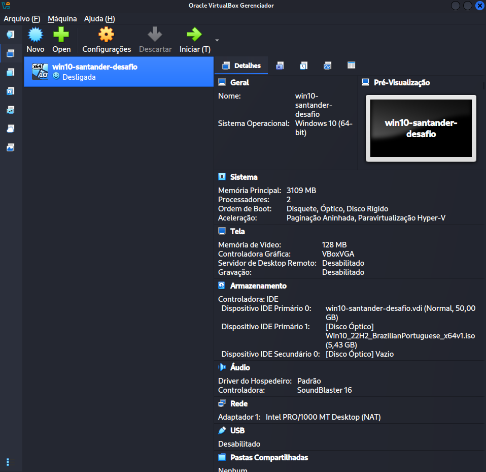
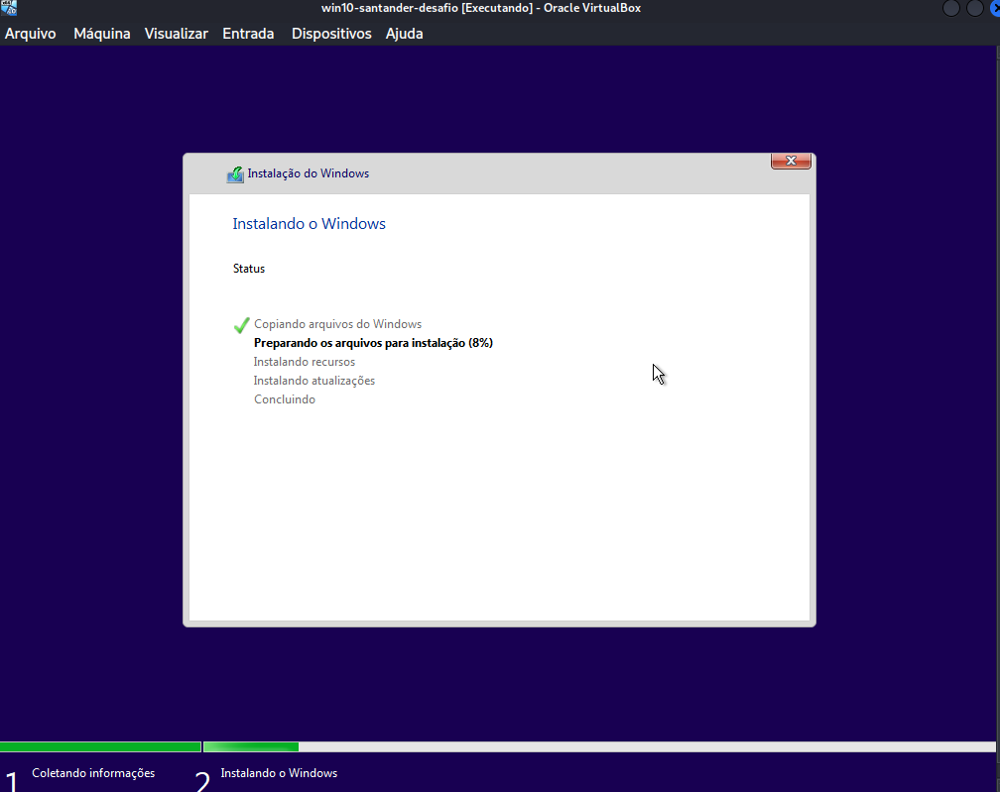

Antes de rodar qualquer coisa, eu desativei o Windows Defender e pausei o Windows Update na VM. Se o Defender estivesse ligado, ele apagaria meus scripts na hora, e o Update poderia reiniciar a máquina no meio do teste.

**As dificuldades na instalação:**
A instalação do Python no Windows foi um capítulo à parte. Fui rodar o `pip` no PowerShell e o Windows respondeu com o clássico 'comando não reconhecido'. Descobri que eu não marquei a caixinha 'Add python.exe to PATH'. Pra não ter que desinstalar tudo, usei o comando `py -m pip install cryptography pynput pyinstaller`, que o instalador registra por padrão. Funcionou de primeira. Depois o `pip` avisou que a pasta `Scripts` não estava no PATH, o que faria o PyInstaller falhar. Utilizei o `py -m PyInstaller` para contornar.

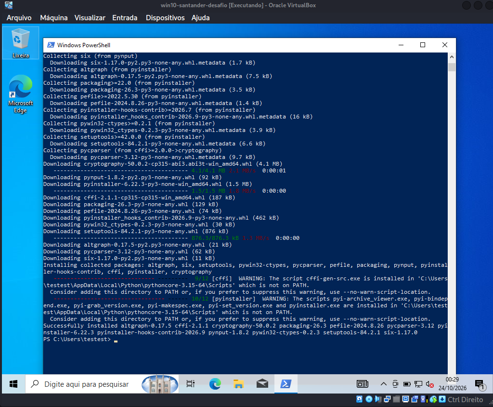

------ 2. O Ransomware:

O ransomware criptografa os arquivos e cobra um resgate. No código, usei a biblioteca `cryptography` com o algoritmo Fernet. O script gera uma chave, varre a pasta, criptografa os `.txt` e cria a nota de resgate.

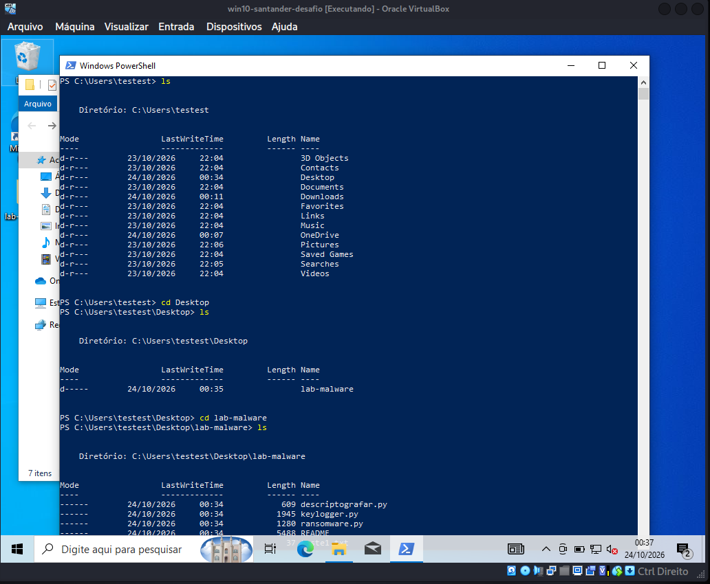
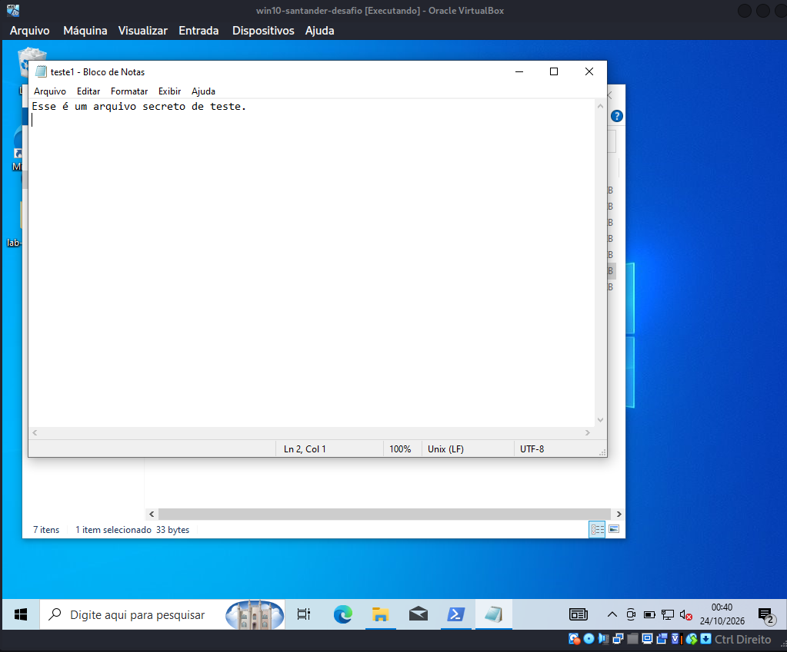

Rodei o script `python ransomware.py` e os arquivos foram embaralhados.

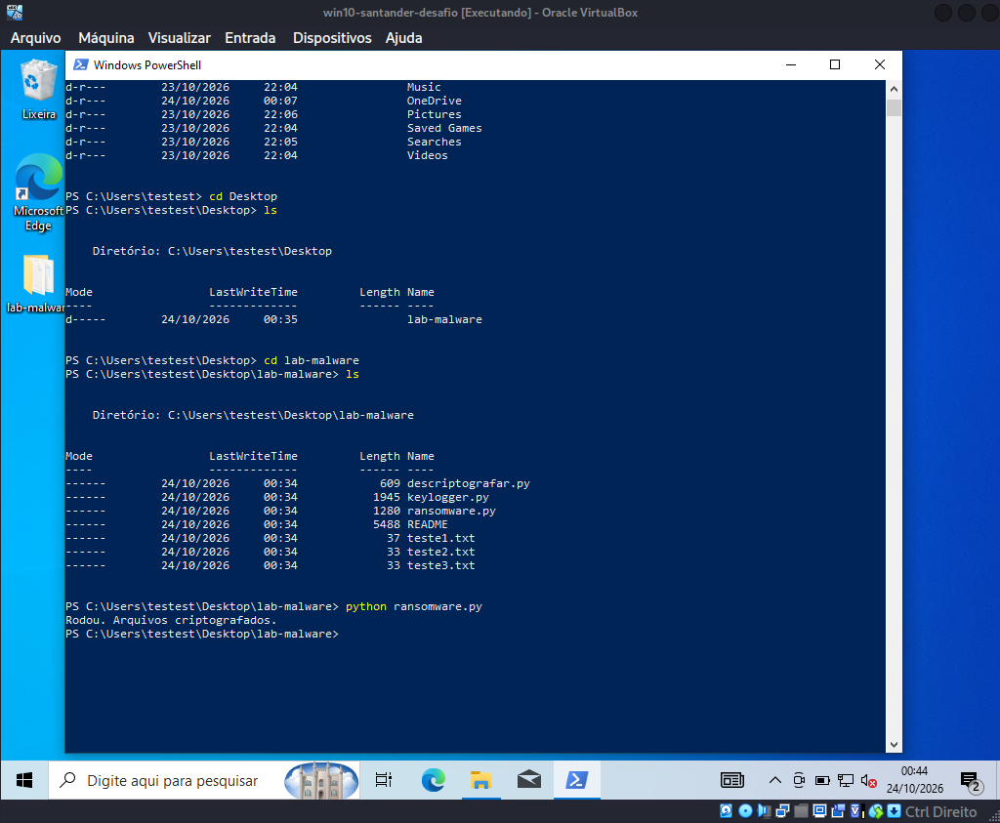
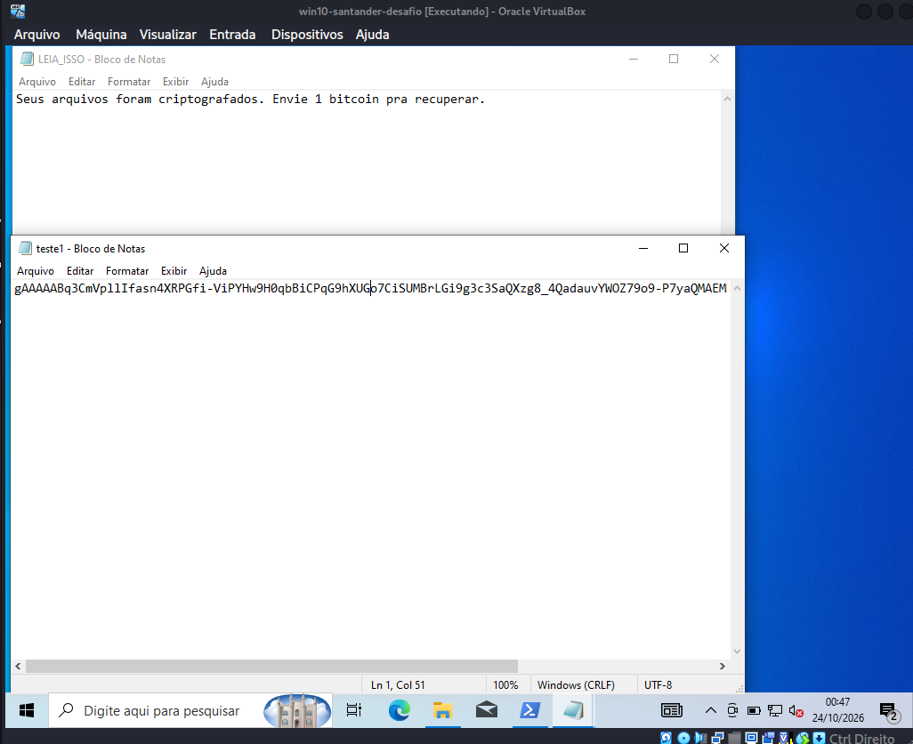

Na sequência, rodei o `descriptografar.py` (que usa a `chave.key`) e recuperei os arquivos. Um detalhe: a nota `LEIA_ISSO.txt` continua na pasta após a descriptografia, porque o código foi feito pra ignorar esse arquivo.

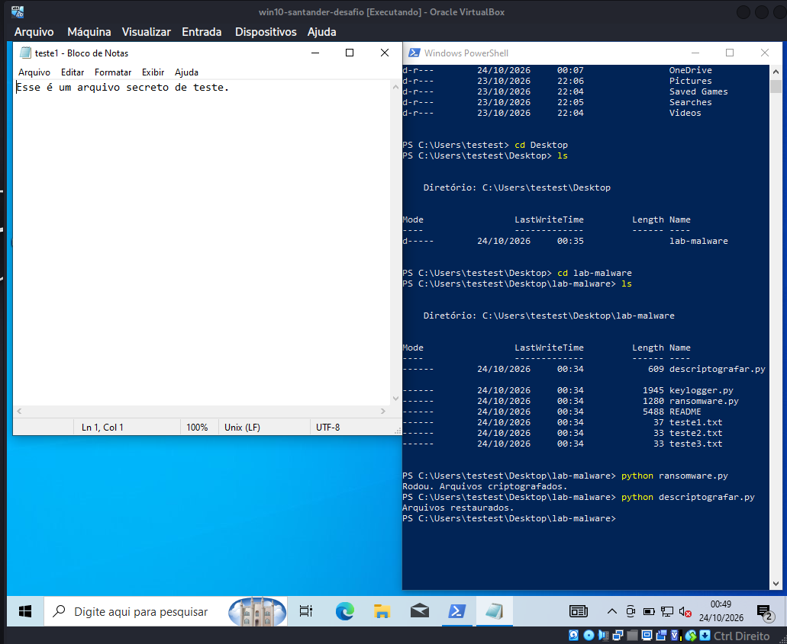

------ 3. O Keylogger

O keylogger utiliza a biblioteca `pynput` para capturar as teclas e registrá-las em um arquivo `log.txt` local. 

**Desafios na exfiltração (envio):**
Durante o laboratório, implementei com sucesso o envio automático por e-mail via SMTP, testando as portas 587 e 465 (SSL). No entanto, o Google bloqueou a criação da credencial necessária para contas novas (Senha de App), e o firewall da VM exigiu ajustes. Para validar o conceito, utilizei uma conta de teste durante os testes.

**Nota de segurança do repositório:** O código de envio de e-mail foi intencionalmente removido desta versão pública. O GitHub possui scanners automáticos que podem classificar scripts que combinam captura de teclado e exfiltração de rede como malware funcional e banir a conta do desenvolvedor. Portanto, o código disponível neste repositório foca apenas na captura local, que é o cerne do funcionamento do keylogger.

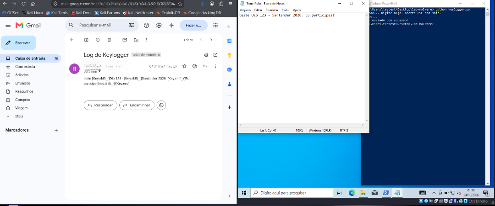

------ 4. Furtividade (Stealth):

O desafio pedia pra tornar o keylogger invisível. Fiz duas coisas:
1. Compilei o script com `py -m PyInstaller --noconsole --onefile keylogger.py`. A flag `--noconsole` remove a janela preta do terminal.
2. Renomeei o `keylogger.exe` gerado na pasta `dist` para `GTA6-Installer.exe`.

Essa é a clássica tática de engenharia social. O usuário desesperado por um jogo pirata baixa o arquivo, executa e não vê nada acontecer na tela. O keylogger roda escondido em segundo plano.

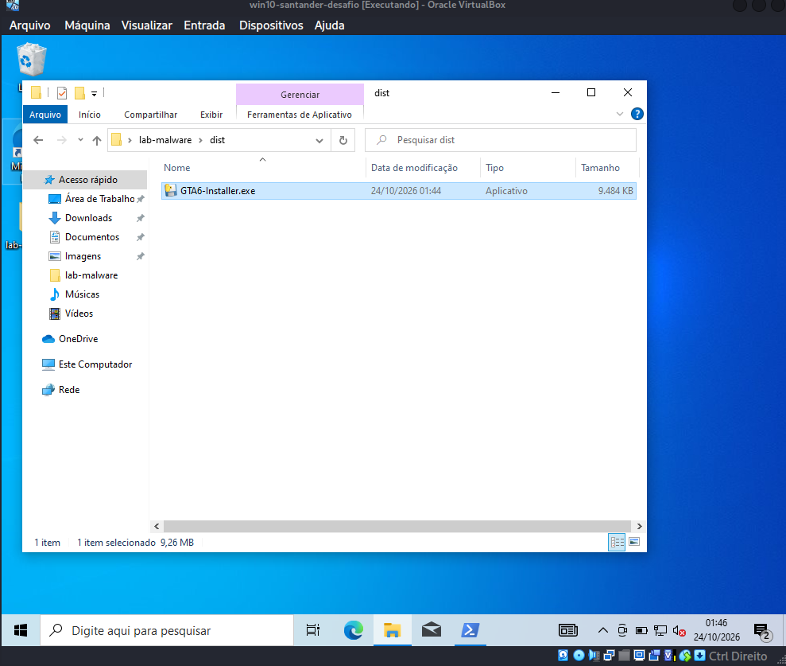
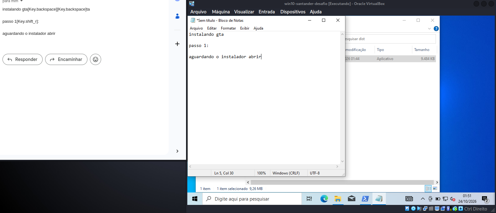

Pra provar que ele rodou escondido, abri o Gerenciador de Tarefas. Sem querer, acabei clicando duas vezes no `GTA6-Installer.exe`, e o sistema abriu dois processos independentes rodando ao mesmo tempo (o que significa que o script não tinha uma trava pra impedir múltiplas instâncias, algo que malwares mais avançados costumam ter). Pra desligar, só matando os processos na mão, porque não tem janela pra clicar no X.

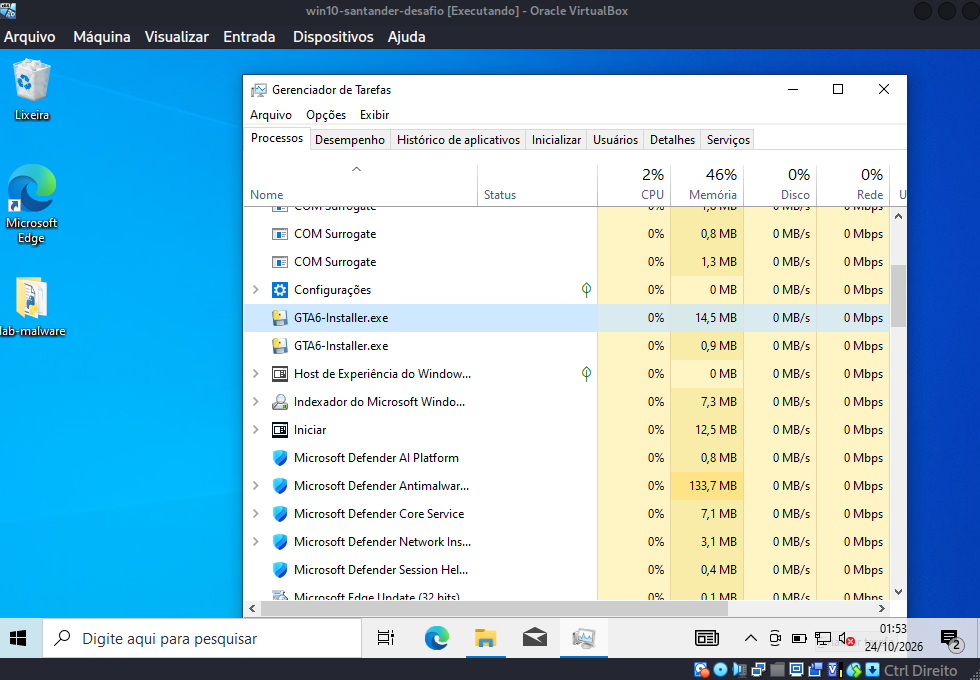

*(Nota: nesse laboratório usei a área de transferência compartilhada pra transferir os scripts. Na vida real, a entrega do malware ocorre por engenharia social, como anexos de e-mail (`fatura.pdf.exe`), links maliciosos ou pendrives infectados. A vítima executa o arquivo por conta própria, sem precisar de uma 'invasão' prévia do atacante.)*

------ 5. O que cada um deveria ter feito pra resistir:

Ransomware:
- A defesa mais eficaz para a recuperação dos dados é o backup offline (em um HD externo que fica desconectado).
- Ter um antivírus com proteção em tempo real, além de monitoramento para detectar alterações em massa de arquivos e a criação de notas de resgate.
- Manter o sistema atualizado para evitar vulnerabilidades.

Keylogger:
- Usar autenticação em dois fatores (MFA). O MFA reduz muito o risco, embora um keylogger ainda possa capturar o código digitado. Métodos como Passkeys (chaves físicas) são mais seguros.
- Usar um gerenciador de senhas (que evita a digitação no teclado, embora malwares avançados possam ler a área de transferência).
- Desconfiar de computadores públicos.
- Não baixar programas piratas (o famoso instalador de jogo falso).

Defesa geral:
- Sandboxing: rodar arquivos suspeitos em uma máquina virtual isolada (como eu fiz aqui).
- Firewall: bloquear a saída de dados não autorizada (ex: um script tentando se conectar ao servidor SMTP do Gmail).
- Conscientização do usuário: treinar as pessoas para reconhecerem phishing e engenharia social.

------ 6. O que aprendi no fim:

O que mais me marcou foi ver na prática como é simples escrever um script que captura tudo e criptografa arquivos. Não precisei de ferramentas avançadas de hacking, só de Python e duas bibliotecas gratuitas. 

Durante os testes, dois pontos chamaram muito a minha atenção. O primeiro foi ver o keylogger rodando invisível, e a única forma de descobrir que ele estava lá foi abrindo o Gerenciador de Tarefas e caçando os processos na mão. O segundo foi o firewall da VM bloqueando o envio do e-mail de exfiltração. Isso me mostrou na prática que controles de rede simples já são capazes de barrar o roubo de dados.

Também ficou claro pra mim que o elo mais fraco não é o software, mas sim o usuário. O ransomware só funciona se a pessoa executar o arquivo. O keylogger só funciona se a pessoa usar o teclado do PC infectado. A conscientização é a defesa mais barata e mais eficiente que existe.

Outra coisa que aprendi foi a importância de isolar o ambiente. Antes de rodar o script, eu tive certeza de que estava numa VM. Essa mentalidade de 'testar primeiro em um ambiente controlado' é a diferença entre um pesquisador de segurança e um criminoso.

------ Referências que usei:
- Python – Documentação Oficial: https://docs.python.org/3/
- Cryptography (Fernet): https://cryptography.io/en/latest/fernet/
- pynput – Biblioteca de Captura de Teclado: https://pynput.readthedocs.io/
- smtplib – Envio de E-mails com Python: https://docs.python.org/3/library/smtplib.html
- PyInstaller: https://pyinstaller.org/
- DIO – Desafio de Projeto (Simulando um Malware de Captura de Dados em Python): https://web.dio.me/project/simulando-um-malware-de-captura-de-dados-simples-em-python-e-aprendendo-a-se-proteger/learning/